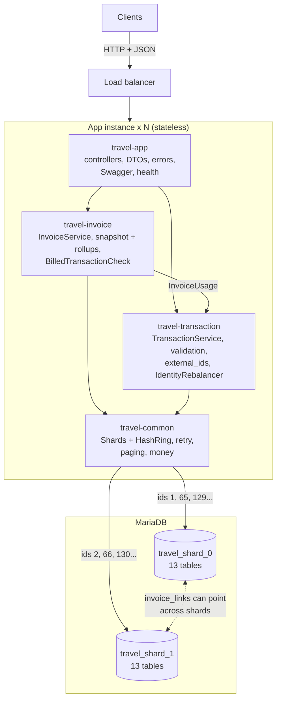
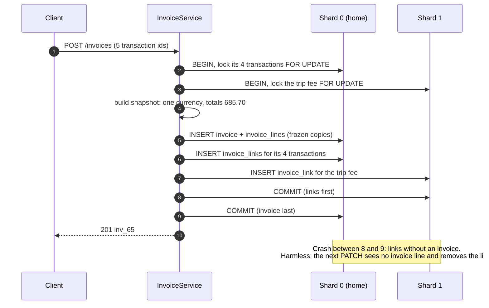
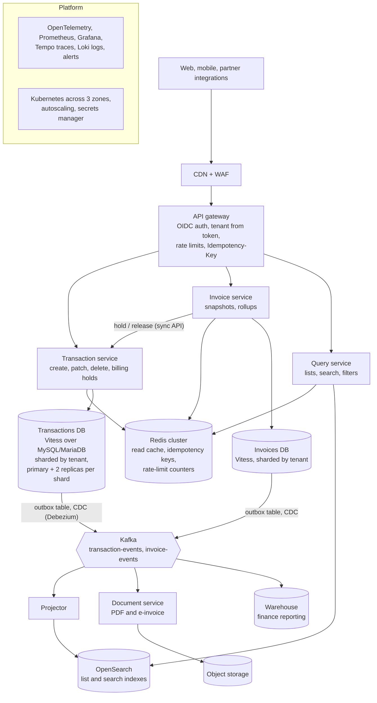

# Architecture

A Spring Boot service that stores travel commerce transactions (flight, hotel, rail, Navan fee) and issues invoices that are frozen copies of them. Data is split across **two MariaDB shards**.

The service is built to **scale out** (more app instances, and rows spread over shards) and to **fail safely** (a crash, retry or race never leaves duplicate, torn or silently changed money). The brief rules out Redis, Kafka and lock services, so both goals rest on a stateless app tier and on the databases themselves: unique indexes, row locks, transactions, and a fixed order for writes that touch two shards.

## 1. Shape



**Modules.** The seams are Maven modules, so the build enforces the dependency direction `travel-app → travel-invoice → travel-transaction → travel-common`. The transaction module cannot reach invoice code. It asks "is this transaction billed?" through the `InvoiceUsage` interface it declares, and the invoice module implements it (`BilledTransactionCheck`). Each module owns the migration for its own tables (`V1` transactions, `V2` invoices); `qShardingConfig` runs both on every shard at start.

| Seam | Code | Owns |
|---|---|---|
| HTTP | `travel-app`: `api.*Controller`, `ApiExceptionHandler` | Routing, DTOs, wire ids (`txn_…`, `inv_…`), cursors, exception → status. No SQL, no rules. |
| Sharding | `travel-common`: `shard.Shards`; `travel-app`: `sharding.ShardingConfig` | Which shard a key or id lives on; running repository code on that shard; one pool, transaction manager and Flyway run per shard. |
| Transaction persistence | `travel-transaction`: `transaction.persistence` | `TransactionWriter` (writes and row locks) and `TransactionLoader` (batched reads); package-private repositories behind them. |
| Duplicate identity | `transaction.identity` | `ExternalIdentity`: the `external_ids` record, lookups and recognising a unique violation. `IdentityRebalancer`: moves records after a shard is added. |
| Input rules | `TransactionDraftFactory` | Turns a create request or a patch into a validated draft. |
| Snapshot and rollup | `travel-invoice`: `invoice.snapshot` | Stored transactions → frozen lines, rollups, totals. No database access. |
| Use cases | `TransactionService`, `InvoiceService` | Which shard, database transaction boundaries, lock and commit order, the 409 rules, retries. |

**Stack:** Java 21, Spring Boot 4.1, Spring JDBC (`JdbcClient`) with hand-written SQL, Flyway, MariaDB (InnoDB). There is no ORM: the hard parts here are SQL-shaped (unique-violation handling, row locks, keyset pages, batched child loads), and every statement the service runs is visible in a repository.

**How repositories reach a shard.** Repositories inject one `JdbcClient`, which is `ShardScopedJdbcClient`: every statement goes to the shard chosen by the surrounding `shards.read(shard, …)` or `shards.inTransaction(shard, …)` call in a service. A repository call outside such a scope fails immediately instead of guessing. Each shard has its own `DataSource` and transaction manager, so a service can hold open transactions on both shards at once.

## 2. Sharding

**Shard key: `external_id`, placed by consistent hashing.** `HashRing` gives each shard 256 points on a ring of 64-bit positions (first 8 bytes of SHA-256 of `"shard-<id>#<n>"`); a key belongs to the first point at or after SHA-256 of the key. The owner is where a new transaction is written and where the key's uniqueness record lives (`external_ids`, written in the same database transaction as the row). So every create, duplicate and racing duplicate for one `external_id` meets **the same** unique index, and uniqueness stays global with no cross-shard check. A tenant or customer key would co-locate invoices better, but the API has no such field, and it would weaken the rule to "unique per tenant". SHA-256 rather than CRC32: booking references share long prefixes and dates, and CRC32 bunched all five seed payloads on one shard.

Why a ring rather than `hash mod N`: going from 2 to 3 shards with `mod N` would reassign about two thirds of all keys, between every pair of shards. On the ring a new shard takes about 1/N of the keys, all from the existing shards to itself, and keys never move between shards that were already there (`HashRingTest` checks both; balance is within a few percent).

**Ids name their shard, for any number of shards.** Shard `s` sets `auto_increment_increment = 64` and `auto_increment_offset = s + 1`, so it issues `s+1, s+65, s+129, …`. `shard = (id − 1) mod 64` routes `GET /transactions/{id}` and `GET /invoices/{id}` without a lookup table, and stays true when shards are added: up to 64, each with a permanent id. An id whose lane has no shard is a 404. Public ids stay opaque strings (`txn_65`), so a different scheme later would not change the API.

**Adding a shard: rows never move.** A transaction stays on the shard that issued its id. What changes owner is the key, and with it the uniqueness record. The procedure (README, "Adding a shard"; run end to end by `AddShardTest`):

1. Configure the new shard and set `previous-ring` to the old shard ids; restart all instances together. A create now checks the key's owner **and** its owner on the previous ring (`Shards.identityShards`) before inserting on the new owner. No instance inserts keys on the old owner any more, so the old owner's records for moved keys are frozen and the extra lookup is race-free; racing creates of a new key still meet one unique index on the new owner.
2. `./run.sh rebalance` copies each misplaced `external_ids` record to its new owner, then deletes it from the old one. At every moment the record is on the old owner, the new owner or both, so step 1's lookup always finds it. Rerunning moves nothing.
3. Remove `previous-ring`; creates are back to one lookup.

Deleting a transaction removes its row first and its uniqueness record after (which may be on another shard). A record left behind by a failure in between points at a row that no longer exists; the next create of that key notices, removes it, and proceeds. In `AddShardTest`, 18 of 45 existing keys changed owner, every one of them to the new shard; all 45 still answered 409 with their original id during and after the move, every row stayed readable, and the trip invoice stayed 685.70.

**Where invoices live.** An invoice's home is the lowest shard holding one of its transactions; its id comes from that shard. A single-transaction invoice therefore sits next to its transaction. The trip in the fixtures spans both shards (the trip fee hashes to shard 1, the rest to shard 0), so `inv_65` lives on shard 0 and bills a transaction on shard 1.

**Invoices across shards, without a distributed commit.** The rule "a billed transaction cannot change" must hold when the invoice and the transaction are on different shards. MariaDB cannot commit two shards atomically (XA would need a transaction coordinator), so correctness comes from **what is written where, and in which order**:

| Table | Shard | Meaning |
|---|---|---|
| `invoice_lines` | invoice's home | The truth: this invoice bills this transaction. |
| `invoice_links (transaction_id, invoice_id)` | transaction's shard | A pointer: "this transaction may be billed by that invoice". `ON DELETE RESTRICT` to `transactions`, so the database refuses to delete a linked transaction. |

1. `InvoiceService` opens a database transaction on each shard involved, in ascending shard order, and locks that shard's transaction rows (`SELECT … FOR UPDATE`). The home is the lowest shard, so it is the outermost transaction.
2. With everything locked, it builds the snapshot, writes the invoice and its lines on the home shard, and writes a link on each transaction's shard.
3. The inner transactions commit first and the home commits last. So **a link always exists before its invoice line is visible**. Removing works the other way: `PATCH` and `DELETE /invoices` commit the invoice first and remove links afterwards.

The trip invoice from the fixtures, which spans both shards:



A missing link therefore always means "not billed". A link can outlive its reason: the invoice commit failed after the links committed, the process died between the two, or the post-commit unlink failed. `BilledTransactionCheck` handles that. `PATCH` and `DELETE /transactions/{id}` hold the transaction's row lock, read its links, and ask each linked invoice's home shard with a **locking read** (`SELECT … LOCK IN SHARE MODE` on `invoice_lines`). A line written by an invoice that has not committed yet is waited for, not missed. If the line exists, 409. If not, the link is a leftover: it is deleted and the edit goes ahead. Leftovers cost nothing until met and are cleaned up when they are.

Live check, against the real server: 30 concurrent PATCHes on a shard-1 transaction raced 10 concurrent trip invoices homed on shard 0. One PATCH committed first; all 10 invoices froze that version (v2, 101.00); the other 29 PATCHes got 409; shard 1 held exactly 10 links for 10 invoices. `ShardingTest` covers routing, link placement, the cross-shard 409, leftover-link cleanup and the `RESTRICT` guard.

**Lists across shards.** A page asks every shard for its newest `limit + 1` rows older than the cursor and merges them. Order is `(created_at, id)` descending, not `id`: ids interleave per shard, so a busier shard's ids run ahead and "highest id" would no longer mean "newest". The cursor is the `(created_at, id)` of the last row returned, and an index on `(created_at, id)` serves the query on each shard. Each page costs one bounded query per shard, at any depth.

**What sharding does not do here.** Both shards are databases on one server in the default setup (`travel_shard_0`, `travel_shard_1`); pointing `SHARD_1_URL` at a second server is a configuration change only. Rows are never moved, so a new shard fills only with new transactions while the old shards keep what they have; moving old rows would need new ids for them, and invoices reference ids. Removing a shard is not supported.

## 3. Tables and models

Every shard has the same schema.

```
transactions ─┬─ transaction_tax_lines        name, rate?, amount
              ├─ transaction_fee_lines        name, amount
              ├─ flight_details ── flight_coupons
              ├─ hotel_details  ── hotel_extras
              ├─ rail_legs
              ├─ navan_fee_details
              └─ invoice_links                 transaction_id, invoice_id (invoice may be on the other shard)

external_ids                                   external_id → transaction_id, on the key's ring owner

invoices ── invoice_lines                      frozen copy per transaction; tax_lines, fee_lines, metadata as JSON
```

| Table | Key columns | Notes |
|---|---|---|
| `external_ids` | `external_id` (**unique**), `transaction_id` | Where `external_id` is unique: on the key's ring owner. Usually beside the row; after shards are added it can point at a row on another shard. |
| `transactions` | `id` `AUTO_INCREMENT` PK (lane per shard, never reused), `external_id` (**unique index**), `type`, `currency`, `occurred_at`, `total`, `version`, timestamps | `CHECK type IN (…)`. `external_id` uses `utf8mb4_nopad_bin`: compared byte for byte, exactly as the router hashes it. `type`, `external_id`, `currency` cannot be patched. |
| `transaction_tax_lines` | PK `(transaction_id, line_no)`, `name`, `rate` nullable, `amount` | Government/VAT-style charges. |
| `transaction_fee_lines` | PK `(transaction_id, line_no)`, `name`, `amount` | Carrier/merchant fees. Its own table: a fee is never a tax line with a flag. |
| `flight_details` | PK `transaction_id`, `origin`, `destination`, `fare` | |
| `flight_coupons` | PK `(transaction_id, coupon_no)`, `carrier`?, `flight_number`, `from_location`, `to_location`, `departure_at`, `arrival_at` | One row per segment. |
| `hotel_details` | PK `transaction_id`, `name`, `address_street`, `address_city`, `address_country`, `check_in`, `check_out`, `nights`, `room_rate_per_night` | Address is three real columns. |
| `hotel_extras` | PK `(transaction_id, extra_no)`, `name`, `amount` | Optional (breakfast). |
| `rail_legs` | PK `(transaction_id, leg_no)`, `origin`, `destination`, `departure_at`, `arrival_at`, `train_number`?, `travel_class`? | A change of train is two rows. |
| `navan_fee_details` | PK `transaction_id`, `fee_kind`, `description`?, `related_external_id`? | `CHECK fee_kind IN ('trip_fee', 'agent_call_fee')`. `related_external_id` is a soft reference: a fee may arrive before its booking, possibly on the other shard. |

Child rows reference `transactions(id) ON DELETE CASCADE`, so deleting a transaction and all its lines is one statement. A transaction and all its child rows always share a shard. The composite primary key on each child table is also the index used to read it in order.

In Java the same structure is a `Transaction` record holding `List<TaxLine>`, `List<FeeLine>` and a sealed `TransactionMetadata` with four records (`FlightMetadata`, `HotelMetadata`, `RailMetadata`, `NavanFeeMetadata`). `MetadataReader` picks the record from `type`, so a flight body cannot be stored as a hotel; `TransactionValidator` rejects `{}` and any missing required field. Unknown `type` or `fee_kind` is a 400. Unknown extra metadata keys are ignored, not stored.

**Why child tables per type.** Typed columns get `NOT NULL` and `CHECK` constraints and can be indexed the day a query needs them (`flight_coupons.flight_number`); the schema documents the model. Single-table inheritance would still need child tables for coupons and legs. The cost is more statements per write, which is bounded (caps on list sizes) and, on reads, batched (§7). JSON is used where it fits: the frozen copies on an invoice line (§5), which are immutable and always read whole.

**Money.** `DECIMAL(19,4)` in the database and `BigDecimal` in Java; JSON numbers are parsed straight to `BigDecimal`. An amount may carry at most the currency's ISO 4217 minor units (EUR 2, JPY 0); more precise input is a 400, never rounded. Responses render amounts at the currency's scale (`220.00`). Tax rates are fractions in `DECIMAL(9,6)` (`0.07`). `total` is the client's gross figure; tax and fee lines break it down and are not added on top. Timestamps are `DATETIME(6)` holding UTC, so no session time zone is involved.

## 4. `external_id` uniqueness and concurrent POSTs

`external_id` identifies a transaction across all types and all shards, compared exactly. The guarantee is the unique index on `external_ids` on the key's ring owner (plus `uq_transactions_external_id` beside the row); application code only decides how to answer.

1. **Identity first.** On the owner (and, while a shard is being added, the previous owner), look up `external_id` (one index probe). If it exists and its row exists, answer 409 before validating the body. This is why the brief's `duplicate_flight` fixture (with `coupons: []`) gets 409, not 400.
2. Validate the body (400 on failure).
3. In one database transaction on the owner insert the header, then tax lines, fee lines and type details, then the `external_ids` record. The header goes first and has its own unique index on `external_id`, so a losing request fails before writing any child row.
4. If the insert violates the unique index, the transaction rolls back, the winner's id is read, and the answer is 409. If the winner is not visible yet, the attempt is retried (§9) and ends in 409 once it is.

Concurrent POSTs all pass step 1, and the index lets exactly one commit. This holds across any number of app instances, because every request for that key goes to the same shard. `DuplicateExternalIdTest` fires 16 simultaneous POSTs per round for five rounds.

**Contract:** duplicate → `409 Conflict`, body `{"error":"duplicate_external_id","transaction_id":"<existing id>",…}` (a transaction's server id is always named `transaction_id`, in the 201 body too) and a `Location` header. The stored row is never modified by a duplicate. A client that times out can safely retry a create.

## 5. Invoice snapshot

Creating an invoice copies; it never links to live data.

| Stored (on the invoice's home shard) | Content |
|---|---|
| `invoices` | `currency`, `total`, `line_count`, `version`, timestamps |
| `invoice_lines` | PK `(invoice_id, line_no)`, one per transaction: `transaction_id` and the copy: `external_id`, `type`, `category`, `currency`, `occurred_at`, `total`, `transaction_version`, and `tax_lines`, `fee_lines`, `metadata` as JSON text. `CHECK` constraints on `type` and `category`. No foreign key to `transactions`: the transaction may be on the other shard. |

`GET /invoices/{id}` reads only the home shard's `invoice*` tables; no read path touches `transactions`. The per-category `totals` and the tax and fee rollups are computed from the frozen lines at read time, so they are frozen too.

**Why JSON for the copied lines, but tables for the live ones.** A transaction's tax and fee lines are edited, validated and loaded in batches, so they get real decimal columns. The invoice's copies are written once, never changed, never queried by name, and always read whole with their line, so a JSON column is the simpler fit; amounts stay exact (`BigDecimal` in, `BigDecimal` out). This replaced four snapshot tables. `InvoiceSnapshotTest` edits the stored flight's total, tax line and coupon with raw SQL and shows the invoice unchanged (flight 220.00, grand total 685.70).

**Rules.**

- Tax rollup groups by `(name, rate)`; fee rollup by `name`. Names are trimmed, rates compare numerically (`0.07` = `0.070000`), a missing rate is its own group, order is first appearance.
- `totals` holds one entry per category plus `grand_total`. The category is the type, except `navan_fee` splits by `fee_kind`, matching `expected-invoice.json`. Each frozen line keeps its `TransactionType` and, for `navan_fee`, its `FeeKind`; `totals` are listed by type, then fee kind, in enum order (`flight`, `hotel`, `rail`, `trip_fee`, `agent_call_fee`). `transaction_types_included` and `navan_fee_kinds_included` are also derived from the frozen lines at read time. `grand_total` is the sum of transaction totals.
- Mixed currencies: 409 `mixed_currency`. The same id twice in one request: 409 `duplicate_transaction_id` (also enforced by `UNIQUE (invoice_id, transaction_id)`). Any missing id: 404 naming it. At most 100 ids.
- A transaction may be on several invoices (the fixture shows single-id and trip invoices over the same flight).

**Three layers keep an invoice frozen:** PATCH or DELETE of an invoiced transaction returns 409 (§2 explains how across shards); `invoice_links` references `transactions` with `ON DELETE RESTRICT`; and the snapshot is a physical copy.

`PATCH /invoices/{id}` rewrites the snapshot from the current transactions in one transaction on the home shard, after linking any newly added transactions; on 404 or 409 the old snapshot is untouched. Links to transactions it dropped are removed after it commits. `DELETE /invoices/{id}` cascades to its own lines, then removes its links. Once no invoice holds a transaction, it becomes editable again.

## 6. Concurrency: who locks what

Isolation is InnoDB's `REPEATABLE READ` plus explicit row locks (`SELECT … FOR UPDATE`) on the shard that owns the row. Any writer whose outcome depends on a transaction's state locks that transaction row first.

| Operation | Locks, in order | Checked under the lock |
|---|---|---|
| `POST /transactions` | none; the unique index on the key's shard decides | |
| `PATCH` / `DELETE /transactions/{id}` | transaction row (its shard), then a share lock on matching invoice lines (each linked invoice's shard) | exists; not billed |
| `POST /invoices` | transaction rows, shards in ascending order, ascending id within a shard | all exist; one currency |
| `PATCH /invoices/{id}` | invoice row (home), then transaction rows by shard and id | same |
| `DELETE /invoices/{id}` | invoice row (home) | |

- Two PATCHes on one transaction serialize on its row lock. Child lists are replaced (delete, insert) only while holding it, so the stored list is always exactly one request's list. `TransactionUpdateDeleteTest` races eight PATCHes with different `tax_lines` and checks for that.
- A PATCH racing an invoice over the same transaction: either the invoice locks the row first and the PATCH then sees its link and returns 409, or the PATCH commits first and the invoice snapshots the new values. Never a mix (see the live check in §2).
- Deadlocks: within a shard InnoDB detects them and the loser is retried. Across shards nothing detects a cycle, so lock order prevents most of them (shards ascending, ids ascending) and `innodb_lock_wait_timeout` (3 s) ends the rest, followed by a retry. Invoice creation always follows the order; `PATCH /invoices` locks its home first, which can wait on a concurrent create across shards until the timeout.

## 7. High volume

| Pressure | What would break | What is in place |
|---|---|---|
| Write volume | One database's write throughput | Writes spread over two shards by `external_id` hash; each create, update and delete touches one shard. Only invoices spanning shards touch both. |
| Large lists | `OFFSET` scans grow with depth; unbounded selects exhaust memory | Keyset pagination on `(created_at, id)` with a matching index per shard; each page reads at most `limit + 1` rows per shard and merges them. `limit` defaults to 50 and is capped at 100; `limit < 1` is 400. No `COUNT(*)`, no offsets, no in-memory paging. |
| Hydrating a page | One query per row per child table | A fixed number of `IN (…)` queries per page per shard: headers, tax lines, fee lines, then one or two per type present. |
| Duplicate POST storms | Wasted writes and lock pile-ups | A duplicate costs one index probe on one shard. Racing duplicates fail on their first statement, before any child row. |
| Concurrent PATCH | Torn lists, lost money | Parent row lock, short transactions, no table locks. |
| "Is it billed?" on every PATCH/DELETE | Scans across shards | One primary-key probe of `invoice_links` on the transaction's own shard; only when a link exists, one unique-key probe of `invoice_lines` on the invoice's shard. |
| Oversized requests | One request holding locks for long | Caps: 100 ids per invoice, 50 tax/fee/extra lines, 20 coupons or legs. |

**Indexes** (in `V1__create_transaction_tables.sql` and `V2__create_invoice_tables.sql`, on every shard; `SchemaTest` checks the uniqueness and billing ones on each shard):

| Index | Serves |
|---|---|
| `transactions` PK | `GET /transactions/{id}`, row locks |
| `uq_external_ids_external_id`, `uq_transactions_external_id` | Duplicate identity |
| `ix_transactions_created_at_id` | List pages |
| Child PKs `(transaction_id, line_no / coupon_no / leg_no / extra_no)` | Ordered, batched child loads |
| `invoice_links` PK `(transaction_id, invoice_id)` | "Is this transaction billed?" |
| `invoices` PK, `ix_invoices_created_at_id` | `GET /invoices/{id}`, list pages |
| `invoice_lines` PK `(invoice_id, line_no)`, `uq_invoice_lines_transaction (invoice_id, transaction_id)` | Lines of one invoice in order; no double count; the locking billing check |

**What fails first.** Hot rows, then each shard's write path. Lock waits on one hot transaction each hold a pooled connection (10 per shard); once a shard's pool is empty, requests for that shard queue. Lock-wait timeout (3 s), statement timeout (10 s) and pool-acquire timeout (3 s) turn that into fast 503s instead of a stall, and those 503s are safe to retry (§9). `DatabaseContentionTest` holds a row lock from a second connection and shows a PATCH returning 503 with `Retry-After` within seconds, then succeeding once the lock is released. Lists cost one query per shard, so they grow with the shard count, not the row count.

## 8. Scaling out

- **App tier:** stateless; add instances behind any load balancer. Correctness does not depend on instance count or routing.
- **Data tier:** two shards today, up to 64. Moving a shard to its own server is a URL change. Adding one is a configuration change, a restart and `./run.sh rebalance` (§2): about 1/N of the keys change owner and no transaction moves.
- **Bounded cost per request:** every query is index-driven and every list, page and payload is capped, so latency stays flat as tables grow.

Next steps, not built: weights on the ring for shards of different sizes; a replica per shard for GETs and lists; a connection pooler once instances × pool size nears a server's connection limit; time-range partitioning of `transactions` and `invoice_lines` within a shard; a periodic sweep of leftover `invoice_links` (today they are cleaned on first touch).

## 9. Fault tolerance

| Failure | Behaviour |
|---|---|
| App crashes mid-request | Open database transactions roll back; a single-shard write is entirely present or absent. `AtomicCreateTest` forces a failure after the header and lines are written and finds no rows. |
| App crashes between the commits of a cross-shard invoice | Links committed, invoice not: the invoice does not exist and the links are leftovers, removed on first touch (§2). The transactions stay editable. The reverse (invoice without links) cannot happen: the home shard commits last. |
| Client times out and retries a create | Idempotent on `external_id`: 201 once, then 409 with the same id. |
| Client retries PATCH or DELETE | PATCH replaces whole fields, so repeating it converges. A repeated DELETE returns 404. |
| Lock-wait timeout, deadlock, racing insert not yet visible | `TransientFailureRetry` re-runs the whole operation up to 4 times with jittered backoff; safe because the failed attempt rolled back on every shard. Then 503. |
| One shard unreachable | Requests that need it answer 503 with `Retry-After: 1`; single-shard requests on the other shard keep working, while lists and cross-shard invoices need both. At start-up both shards must be reachable for their migrations. `/health/readiness` checks each shard, `/health/liveness` does not, so a load balancer drains the instance without restarting it. |
| Instance stopped or redeployed | No local state to lose; graceful shutdown lets in-flight requests finish (20 s). |
| Several instances start together | Flyway locks each shard's history table, so migrations run once per shard. |

**Known gap.** `POST /invoices` is not idempotent: a retried request creates a second invoice. The fix is an `Idempotency-Key` header stored in a nullable unique column on `invoices`, the same technique as `external_id`.

## 10. Decisions that could have gone the other way

| Decision | Alternative | Why this one |
|---|---|---|
| Shard by `external_id` | Shard by tenant / customer | Keeps global `external_id` uniqueness exact with one index; the API has no tenant. The cost is invoices that span shards, handled by the link protocol (§2). |
| Consistent-hash ring (256 points per shard) | `hash mod N`, or a fixed bucket table | Adding a shard moves about 1/N of the keys and only to the new shard; no table to maintain. |
| Uniqueness records move, rows stay | Move rows to their new owner | Ids name the shard holding the row and invoices reference ids; moving a 2-column record is trivial and safe to repeat. |
| Link before invoice, unlink after; repair on read | XA two-phase commit | No transaction coordinator to run or recover; the only failure leftover (a stale link) is harmless and self-healing. |
| `AUTO_INCREMENT` ids in 64 lanes | UUIDs or a lookup table | Ids stay short and readable, and an id alone routes to its shard however many shards are added. |
| Lists ordered by `(created_at, id)` | By `id` | Ids from different shards do not interleave in time; creation time does. |
| Duplicate `external_id` returns 409 | 200 with the existing resource | The client can tell "created" from "already existed", and a body that differs from the stored one is not reported as success. |
| Same id twice on an invoice returns 409 | Dedupe silently | A repeated id is a client bug worth surfacing. |
| `limit` above 100 is clamped | 400 | Clients still page correctly; the response states the effective limit. |
| Cursor paging only | Also accept `offset` | Offsets get slower with depth, need every shard to skip rows, and skip or repeat rows under concurrent inserts. |
| Hard delete | Soft delete | The brief asks for deletion; a deleted `external_id` can be reused. |
| Flight needs ≥ 1 coupon, rail ≥ 1 leg, hotel `nights` = days between dates | Accept anything structurally valid | A ticket without a segment is not a ticket. |
| `total` not cross-checked against its parts | Enforce fare + taxes + fees = total | Inclusive and exclusive pricing differ by type; the client's gross is authoritative. |

## 11. Where this goes at high scale (not built)

The brief rules out Redis, Kafka and lock services, and the current design does not need them to be correct. This is the target if traffic grew by orders of magnitude and the team split into several services. None of the correctness rules change: money stays decimal, `external_id` stays unique at one database index, invoices stay frozen copies, and "billed" still means a hold written before the invoice and released after it.



| Piece | What it adds | What it replaces or changes here |
|---|---|---|
| API gateway | Authentication, a tenant id on every request, per-client rate limits, `Idempotency-Key` checks | The brief has no auth. With a tenant id, invoices and their transactions can share a shard, and `external_id` becomes unique per tenant, which is how booking references really behave. |
| Transaction service | Owns transactions and the rule "a billed transaction cannot change" | Today's `travel-transaction` module. `invoice_links` become **billing holds** that it owns: the invoice service asks for a hold before committing an invoice and releases it after deleting one. That is the same ordering as today's links, now across services, so the design ports without a distributed commit. |
| Invoice service | Owns snapshots and rollups | Today's `travel-invoice` module, with its own database. |
| Redis | Cache-aside for `GET /transactions/{id}` and `GET /invoices/{id}`, idempotency keys, rate-limit counters | Invoices are immutable per version, so the key `inv:{id}:v{version}` never needs invalidating. Transactions are evicted on their change event. **Redis is never the source of truth**: uniqueness and billing still live in the database. It also closes today's known gap, idempotent `POST /invoices`. |
| Outbox + CDC + Kafka | Every state change is published once, in the same database transaction that made it | Lets the read side, documents and reporting follow the write side without dual writes or polling. |
| Query service + OpenSearch | Lists, filters and search, served from an index fed by events | Today's merge-across-shards on every page. One index query replaces N shard queries, and filters such as by date, type or traveller come almost free. Lists become eventually consistent, typically by under a second; reads by id stay on the primary path. |
| Vitess | Sharding as infrastructure: routing, online resharding that moves rows, replicas, connection pooling | Today's `HashRing`, `ShardScopedJdbcClient`, id lanes and `rebalance` command. The idea is the same, but it runs in a proxy that also moves the rows. |
| Read replicas | Cheap reads | `GET` by id and the projector's catch-up reads go to replicas; writes and locking reads stay on primaries. |
| Document service + object storage | PDF and e-invoice rendering | Driven by `invoice-events`; the rendered file is immutable, like the snapshot. |
| Observability | Traces across services, RED metrics per endpoint, alerts on 409/503 rates and consumer lag | Needed once a request crosses more than one process. |
